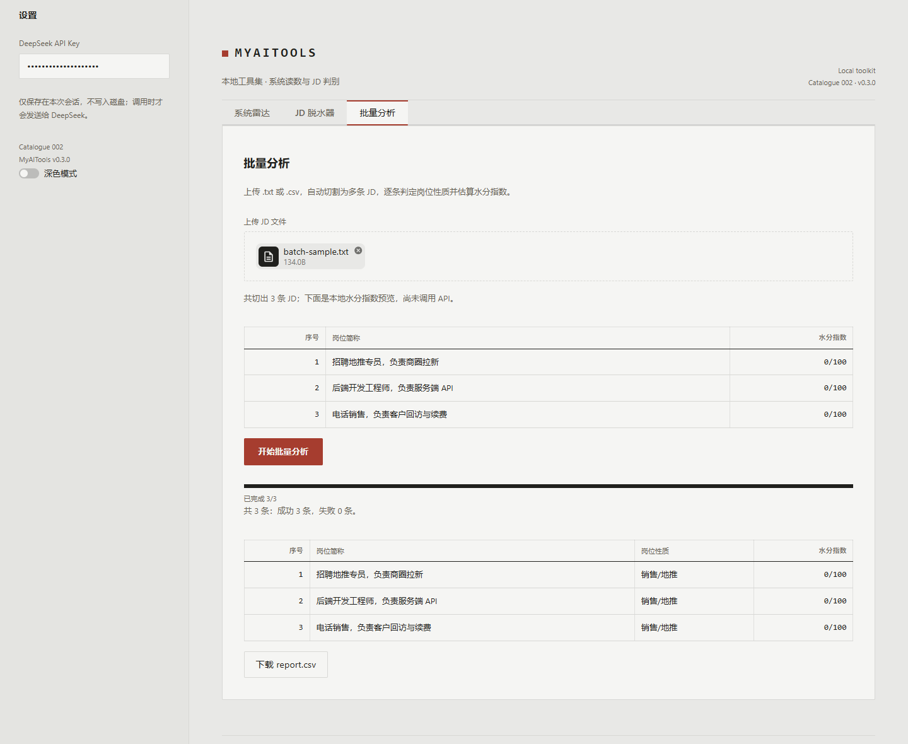

# MyAITools 优化总结（2026-10-29）

## 一句话结论

这一轮把 `jd-detector` 从"能批量跑"升级为"敢批量跑"：**并发 + 重试 + 缓存 + 安全报告 + GUI 批量页**，同时补齐跨平台 CI、Dependabot 与安全政策，最终以 **v0.3.0** 发布。

## 一、本次完成

### 1. jd-detector 批量流水线加固

| 能力 | 说明 |
| --- | --- |
| 并发 | `--workers 1-16`（默认 4），线程池并发调用，结果顺序保持不变 |
| 重试 | 超时 / 连接失败 / HTTP 408·409·425·429·5xx 自动指数退避重试（`--retries`、`--retry-delay`） |
| 缓存 | 按「模型 + JD 文本 hash」缓存成功结果到 `.cache/jd-detector.json`，重复运行不重复计费；`--no-cache` 可关 |
| 预览 | `--dry-run` 只切割并展示将分析的 JD 与本地水分指数，不调用 API |
| 限额 | `--limit N` 只分析前 N 条，方便小样本试跑 |
| 容错 | 单条永久失败只记录「分析失败」，整批继续；报告照常生成 |

### 2. 报告与安全

- `report.csv` 保持 UTF-8 BOM，Excel 直接打开
- **CSV 公式注入防护**：岗位简称若以 `=` `+` `-` `@` 开头，会加 `'` 前缀，避免 Excel 执行公式
- 新增 `SECURITY.md`：说明 Key 处理、漏洞私下报告方式与敏感文件忽略策略

### 3. GUI 批量分析页

新增第三个标签页「批量分析」，与 CLI 共用同一套 `load_bytes` / `analyze_batch` 逻辑：

1. 上传 `.txt` / `.csv`
2. 预览切割条数与本地水分指数
3. 点击「开始批量分析」，显示逐条进度
4. 结果表（序号 / 岗位简称 / 岗位性质 / 水分指数）
5. 一键下载 `report.csv`



### 4. 工程基建

- CI 从单平台扩展为 **Ubuntu（3.10–3.14）+ Windows 3.14 + macOS 3.14**
- 新增 Dependabot：pip 每周、GitHub Actions 每月
- 新增安全政策、批量测试文件 `tests/test_jd_batch.py`
- 设计侧保持「精密档案卡」世界不变，新增批量组件样式（上传区 / 数据表 / 进度条 / 下载按钮）

## 二、验证结果

| 检查 | 结果 |
| --- | --- |
| pytest | **82 passed**（新增批量切割、CSV、重试、缓存、并发顺序、dry-run、limit、CSV 注入等用例） |
| ruff check / format | 通过 |
| AppTest（GUI） | 通过，覆盖三标签页与批量空状态 |
| impeccable detect | `[]`（无机械问题） |
| taste app inspector（此前终审） | 0 FAIL；仅 1 条可辩护 WARN：本地系统字体 Consolas 未被浏览器 `document.fonts` 识别（离线优先的设计选择） |
| GUI 批量页实测 | Playwright 上传样例文件 → 预览 → 分析 → 结果表 → 下载按钮，全流程通过 |

## 三、怎么用

### CLI

```powershell
cd F:\项目\MyAITools
.\.venv\Scripts\Activate.ps1
$env:DEEPSEEK_API_KEY = "sk-你的key"

# 先预览，不花钱
python -m myaitools jd-detector --file jds.txt --dry-run

# 4 路并发 + 自动重试 + 缓存
python -m myaitools jd-detector --file jds.txt --workers 4 --retries 2

# 只跑前 10 条，不写缓存
python -m myaitools jd-detector --file jds.txt --limit 10 --no-cache
```

### GUI

```powershell
streamlit run src/myaitools/app.py
```

打开 <http://localhost:8501> → 「批量分析」→ 上传 txt/csv → 开始批量分析 → 下载 `report.csv`。

## 四、版本与发布

- `__version__ = "0.3.0"`；CHANGELOG 已记录 `[0.3.0] - 2026-10-29`
- 说明：此前 v0.2.0 已发布，本次批量能力作为 **v0.3.0** 发布，避免改写已发布版本
- 打 `v0.3.0` 标签后，Release 工作流会自动从 CHANGELOG 生成 GitHub Release

## 五、尚未完成 / 下一轮建议

按优先级：

1. **发布到 PyPI**（Trusted Publishing）：需要先注册 PyPI 账号并确认包名可用；完成后 README 可改为 `pip install myaitools`
2. **sys-radar 增强**：`--watch` 持续监控、CPU/内存/磁盘阈值告警（超限非 0 退出）、`--top` 进程排行
3. **质量基线**：覆盖率门槛（`--cov-fail-under`）、mypy/pyright 类型检查、`py.typed`
4. **文档站**：MkDocs Material / GitHub Pages，加入批量分析演示 GIF
5. **报告增强**：可选输出置信度与理由列、失败明细单独文件、`--resume` 断点续跑
6. **插件机制**：entry points 自动发现第三方工具（架构级改动，等工具稳定后再做）

## 六、链接

- 仓库：<https://github.com/merci-L/MyAITools>
- README：<https://github.com/merci-L/MyAITools/blob/main/README.md>
- 批量说明：<https://github.com/merci-L/MyAITools/blob/main/docs/jd-detector.md>
- CI：<https://github.com/merci-L/MyAITools/actions>
- 设计规范：<https://github.com/merci-L/MyAITools/blob/main/DESIGN.md>

> 本次改动的工作区里有一个与本项目无关的未跟踪目录 `DataWizard/`，未修改、未提交。
